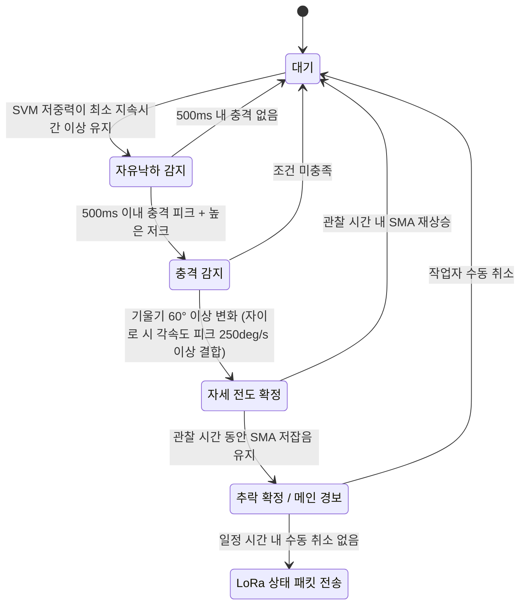

# 로직 구상: 추락 감지 및 장시간 미동 감지

조선 블록 작업자 착용 노드에서 **추락**과 **장시간 미동(의식 소실)** 을 판정하고, LoRa 메시로 상태를 전송하기 위한 감지 로직 구상안입니다.

## 목차

- [용어 정리](#용어-정리)
- [1. 추락 감지](#1-추락-감지)
  - [1.1 자유낙하 감지](#11-자유낙하-감지)
  - [1.2 충격 및 에너지 피크 검출](#12-충격-및-에너지-피크-검출)
  - [1.3 중력 벡터 기반 자세 전도 판정](#13-중력-벡터-기반-자세-전도-판정)
  - [1.4 사후 정지 검증 및 단계적 경보](#14-사후-정지-검증-및-단계적-경보)
- [2. 장시간 미동 감지](#2-장시간-미동-감지)
  - [2.1 중력 분리 및 신호 크기 영역 활동량 산출](#21-중력-분리-및-신호-크기-영역-활동량-산출)
  - [2.2 조선 블록 기계 진동 필터링](#22-조선-블록-기계-진동-필터링)
  - [2.3 자세 추정 기반 가변 타이머 적용](#23-자세-추정-기반-가변-타이머-적용)
  - [2.4 단계적 경보 및 LoRa전송 확정](#24-단계적-경보-및-lora전송-확정)
  - [2.5 자이로센서 이용 시 보강 로직](#25-자이로센서-이용-시-보강-로직)
- [부록. 상태 패킷 비트 구성](#부록-상태-패킷-비트-구성)

## 용어 정리

| 약어 | 의미 | 본문 내 용도 |
|---|---|---|
| SVM | 3축 가속도 합성 벡터 크기 | 자유낙하·충격 판정 |
| SMA | 신호 크기 영역 (동적 가속도 절댓값의 시간 적분) | 사후 정지·미동 판정 |
| FSM | 유한 상태 머신 | 추락 4단계 순차 판정 |
| LPF | 저역통과필터 | 중력 성분(정적 가속도) 분리 |
| HPF | 고역통과필터 | 동적 가속도 성분 추출 |
| 저크(Jerk) | 시간당 가속도 변화율 | 실제 충돌과 완만한 압력 변화 구분 |

---

## 1. 추락 감지

추락 판정은 **자유낙하 → 지면 충돌 → 자세 전도 → 사후 정지**의 4단계 순차 전이를 조건으로 하는 유한 상태 머신(FSM)으로 구현한다. 각 단계는 정해진 시간창 내에 다음 단계로 전이되지 못하면 FSM이 초기 상태(대기)로 리셋된다.

### 1.1 자유낙하 감지

3축 가속도 합성 벡터 크기(SVM)가 자유낙하 임계값(중력가속도 대비 약 0.4\~0.6g 이하) 미만으로 일정 시간(예: 50\~150ms) 이상 지속되는지를 판정한다.

단순 보행 시 뒤꿈치 착지 직전 발생하는 수십 ms 단위의 순간적 중력 감소 노이즈를 걸러내기 위해, 최소 지속시간 조건(시간 윈도우 필터)을 둔다. 이 최소 지속시간보다 짧게 끝나는 저중력 구간은 노이즈로 간주하고 무시한다.

이 단계를 통과하면 FSM은 자유낙하 감지 상태로 전이하고, 내부 타이머를 시작한다.

### 1.2 충격 및 에너지 피크 검출

자유낙하 감지 시점으로부터 **500ms 이내**에 지면 충돌로 인한 급격한 가속도 피크가 발생해야 한다.

- **SVM 임계값:** 일반 작업 중 발생하는 충격(망치질, 물건 내려놓기 등)은 통상 1.5\~2g 수준까지 관측될 수 있으므로, 이를 정상 작업의 참고 상한치로 두고, 실제 추락 판정 임계값은 2.5\~3g 이상으로 설정한다. 이 값은 노드 착용 위치에 따라 현장 보정이 필요하다.
- **저크(Jerk) 검사:** 직전 샘플과의 가속도 차이값(시간당 가속도 변화율)을 계산하여 충격을 평가한다. 단순히 주저앉거나 물건을 압박하는 완만한 압력 변화는 저크 값이 낮게 나타나는 반면, 실제 바닥 강타는 매우 짧은 시간에 큰 저크 값을 보이므로 이를 구분 조건으로 사용한다.

이 조건을 만족하면 FSM은 충격 감지 상태로 전이한다. 500ms 내 충격이 발생하지 않으면 FSM은 대기 상태로 리셋된다(단순 공중 동작이나 센서 일시 가림 등으로 판단).

### 1.3 중력 벡터 기반 자세 전도 판정

충돌 직후 작업자가 실제로 쓰러졌는지(수평 전도)를 판정한다. 이 단계는 가속도계 기반 방식과 자이로 보강 방식으로 나뉜다.

#### 가속도계 단독 방식

1. 저역통과필터(LPF)로 중력 성분(정적 가속도)을 분리한다.
2. 충돌 전 1\~2초 구간의 평균 중력벡터 방향과, 충돌 후 잔여진동이 가라앉은 뒤 1\~2초 구간(충돌 시점 기준 약 0.5\~2초 후부터 측정 시작)의 평균 중력벡터 방향 사이의 내적(코사인 유사도)을 계산해 자세 기울기 각도를 산출한다.
3. 기울기 각도가 **60° 이상** 변화했으면 수평 전도로 판정하고 다음 단계로 전이한다. 60° 미만이면 FSM을 리셋한다.

#### 자이로 보강 방식

가속도계 LPF 기반 중력벡터 추정(저주파, 느리지만 안정적)과 자이로 적분 기반 상대 회전각을 상보필터로 융합한다.

$$
\theta_t = \alpha \left( \theta_{t-1} + \omega \cdot dt \right) + (1 - \alpha)\, \theta_{acc}
$$

- $\theta_t$: 추정각도, $\theta_{t-1}$: 이전각도, $\omega$: 자이로 각속도, $\theta_{acc}$: 가속도계 기반 각도
- α는 0.95\~0.98 범위에서 튜닝.

자이로 적분은 충돌 시점부터 짧은 관찰 창(0\~2초) 내에서만 수행하여 드리프트 누적을 최소화한다.

보강 조건으로, 충돌 순간 3축 각속도 합성벡터가 **250deg/s 이상** 치솟는지를 함께 확인한다. 회전 피크가 없는 상태에서의 단순 직선 충격(벽 부딪힘, 무거운 공구 내려놓기 등)은 이 조건에서 걸러져 FSM이 리셋된다.

최종 판정은 **"융합 각도 60° 이상 변화" AND "충돌 순간 각속도 피크 250deg/s 이상"** 의 결합 조건으로 수행하여 오경보를 추가로 억제한다.

### 1.4 사후 정지 검증 및 단계적 경보

자세 전도가 확정되면, 충격 후 일정 관찰 시간(예: 10\~20초) 동안 동적 가속도(고역통과필터 통과 성분)의 SMA(신호 크기 영역) 값이 저잡음 임계치 이하로 유지되는지를 확인한다.

- **정량 판정 기준:** 관찰 시간 N초 동안 SMA가 연속으로 임계값 이하를 유지하면 '의식 불명 추정'으로 판정한다.
- 가벼운 미끄러짐 후 즉시 일어난 경우에는 관찰 시간 내에 SMA가 다시 상승하므로 정지 조건을 만족하지 못하고 FSM이 대기 상태로 리셋된다.
- 자이로 탑재 노드의 경우, 동일 관찰 창에서 각속도 분산도 함께 확인하여 가속도 기반 판정을 교차 검증한다.

사후 정지가 확정되면 추락을 최종 확정하고, 1바이트 상태 패킷의 추락 비트를 세팅한다. 이때 노드는 즉시 메인 경보(부저+진동)를 발생시키되, 일정 시간(예: 10\~15초) 내에 작업자가 수동으로 경보를 취소하지 않으면 LoRa 메시를 통해 상태 패킷을 전송한다

---

## 2. 장시간 미동 감지

밀폐공간 내 질식, 유독가스 노출, 탈진 등으로 쓰러져 의식을 잃은 작업자를 검출한다. 핵심 난점은 조선 블록 특유의 외부 기계 진동(용접, 그라인딩)의 유입과 정밀 작업을 위해 가만히 정지한 정상 상태를 구분하는 것이며, 이를 위해 **주파수 대역 분리 기반 SMA 지표**와 **자세별 차등 타이머**를 결합한다.

### 2.1 중력 분리 및 신호 크기 영역 활동량 산출

디지털 고역통과필터로 중력 성분을 제거한 순수 동적 가속도 성분을 추출하고, 일정 시간 단위(예: 1초) 동안 동적 가속도 절댓값의 적분값(SMA)을 계산한다. 의식 소실 상태에서는 SMA가 시스템 최저 잡음 레벨로 수렴한다.

### 2.2 조선 블록 기계 진동 필터링

블록 철판을 타고 전달되는 외부 기계 진동(용접, 그라인딩 등)은 고주파 대역에, 작업자의 자발적 신체 움직임은 저주파 대역(대략 0.3\~10Hz 수준, 현장 보정 필요)에 집중되는 경향을 이용한다.

이동평균 및 대역통과필터를 적용해 고주파 기계진동 에너지를 신체 활동량 판정에서 배제한다.

> **보완 사항:** 저주파/고주파 경계 컷오프 주파수는 문헌값만으로 확정할 수 없으므로, 현장조사 단계에서 실제 용접·그라인딩 작업 중 발생하는 진동을 FFT로 수집·분석하여 컷오프 주파수를 실측 기반으로 보정하는 절차를 캘리브레이션 과정에 포함한다.

자이로 탑재 노드의 경우, 가속도 기반 판정과 별개로 [2.5절](#25-자이로센서-이용-시-보강-로직)의 각속도 분산 기준을 교차 검증 조건으로 추가하여 필터링 신뢰도를 높인다.

### 2.3 자세 추정 기반 가변 타이머 적용

저역통과필터(LPF)로 추출한 중력벡터의 3축 방향 분석을 통해 작업자의 현재 체위를 직립/수평으로 분류하고, 자세에 따라 서로 다른 유예 시간을 적용한다.

| 자세 상태 | 해석 | 유예 시간 |
|---|---|---|
| 직립 + SMA 저활동 | 휴식 또는 정밀 조립 작업 중 정지일 가능성이 높음 | 긴 유예시간 (예: 3\~5분) |
| 수평(전도) + SMA 저활동 | 쓰러져 실신했을 가능성이 높음 | 짧은 유예시간 (예: 1분) |

> **주의사항:** 본 로직은 노드가 몸통에 고정 착용된 경우를 전제로 하며, 손목·팔 착용형 노드에서는 팔의 위치만으로 몸 전체의 자세를 오판할 수 있다. 손목 착용형의 경우 자세 판정 비중을 낮추고 SMA 단일 기준에 가까운 단일 타이머(예: 2분 내외) 운용을 병행 검토한다.

### 2.4 단계적 경보 및 LoRa전송 확정

1. 자세별 임계 시간이 만료되면 즉시 외부로 패킷을 전송하지 않고 **1단계 로컬 예비 경보**를 발동한다.
2. 부저를 간헐적으로 울리고 진동을 약 15초간 가동하여, 단순 휴식 중인 작업자가 몸을 조금만 뒤척여도 SMA(및 자이로 탑재 시 각속도) 변화가 감지되어 미동 타이머가 자동 리셋되도록 한다.
3. 예비 경보 시간 동안에도 가속도(및 각속도) 변동이 발생하지 않으면 의식 상실로 최종 확정하고, **메인 경보**를 울리며 LoRa 1바이트 상태 패킷의 미동 비트를 활성화하여 개구부 방향으로 브로드캐스팅한다.

### 2.5 자이로센서 이용 시 보강 로직

#### (A) 외부 진동 대비 무반응 상태 분별

자이로센서는 직선 병진 진동(철판을 타고 전달되는 기계 진동)에는 반응하지 않고 회전 운동에만 반응하는 특성을 이용한다.

- 일정 관찰 윈도우(예: 2\~5초) 동안 3축 각속도의 표준편차(분산)를 계산한다.
- 이 분산이 기준치(약 3\~5deg/s, 현장 보정 대상) 이하이고, 동시에 가속도 기반 SMA도 저잡음 수준이면 '실제 무반응' 상태 후보로 판정한다.
- 용접·그라인딩 등 외부 기계진동으로 가속도 SMA가 일시적으로 높게 나오더라도, 이는 선형 진동이 주된 성분이므로 각속도 분산은 낮게 유지된다. 이 특성을 이용해 가속도 SMA만으로 오판(미동 타이머 리셋)되는 것을 자이로 분산 조건으로 교차 검증하여 차단한다.

#### (B) 정상 정지 작업과 의식 소실의 구분

(A)의 각속도 분산 기반 무반응 판정만을 핵심 보강 로직으로 채택한다.

- **보조 지표(선택적):** 수 분 단위 관찰 창 내에서 아주 작은 각속도 돌발 피크(예: 0.5\~1deg/s 수준의 순간적 변화, 뒤척임·고개 끄덕임 등)가 전혀 없는지를 보조 지표로 활용하여, 정밀 작업 중 발생하는 미세한 의도적 움직임과 완전한 무의식 상태를 조금 더 세밀히 구분하는 데 참고한다.

#### (C) 자이로 적용 시 자세 판정 보강

자이로 적분 기반 상대 회전각을 미동 감지의 자세 판정에도 동일하게 적용하여, 가속도계 단독 방식 대비 잔여 진동에 덜 민감한 자세 추정이 가능하도록 한다. 단, 장시간 미동 감지는 관찰 시간이 길기(최대 수 분) 때문에 자이로 적분을 장시간 그대로 유지할 경우 드리프트가 누적될 수 있으므로, 주기적으로(예: 수 초\~수십 초마다) 가속도계 기반 중력벡터로 자이로 적분각을 재보정(reset/correction)하는 절차를 둔다.

---

## 부록. 상태 패킷 비트 구성

본문에서 언급된 1바이트 상태 패킷의 비트입니다. 비트 위치와 나머지 비트의 용도는 아직 정해지지 않았습니다.

| 비트 | 이름 | 세팅 조건 | 관련 절 |
|---|---|---|---|
| 미정 | 추락 비트 | 사후 정지 확정 후, 수동 취소 없이 유예 시간 경과 | [1.4](#14-사후-정지-검증-및-단계적-경보) |
| 미정 | 미동 비트 | 예비 경보 중 움직임 없음 → 의식 상실 최종 확정 | [2.4](#24-단계적-경보-및-lora전송-확정) |
| 미정 | (예약) | — | — |
